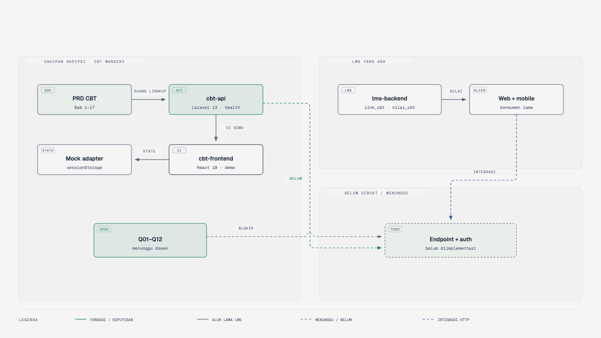

# cbt-frontend — Antarmuka Web CBT U-Cademy

Frontend web untuk layanan CBT mandiri U-Cademy. Fase ini difokuskan pada **pengembangan dan demonstrasi** antarmuka peserta serta instruktur dengan `cbt-api` melalui adapter contoh. Repositori ini **belum untuk produksi** dan tidak menggantikan alur CBT yang sudah ada di LMS.

- Layanan API: [`cbt-api`](https://github.com/irgifebry/cbt-api)
- Catatan untuk skripsi: [Catatan skripsi — antarmuka web CBT](docs/cbt-ui-catatan-skripsi.md)
- Kebutuhan dan batas: [`CBT-API.md`](CBT-API.md) · [matriks kebutuhan](docs/cbt-requirements-matrix.md) · [catatan konsultasi](docs/pertanyaan-konfirmasi-dosen-pembimbing-cbt.md)

## Diagram cakupan

<p align="center">
  
</p>

Versi sumber: [HTML](docs/diagram-cakupan.html) · [SVG](docs/diagram-cakupan.svg).

## Menjalankan secara lokal

```bash
npm install
cp .env.example .env
npm run dev -- --host 127.0.0.1
```

## Antarmuka CBT (pengembangan)

Bagian ini mendokumentasikan antarmuka web CBT di repositori ini untuk keperluan **pengembangan dan demonstrasi**. Antarmuka ini **tidak untuk produksi** dan **tidak menggantikan** alur CBT yang sudah ada di LMS (`link_cbt` / `token_cbt` / `nilai_cbt`). Alur lama tetap menjadi satu-satunya jalur yang didukung untuk tugas CBT. Pekerjaan ini tidak mengubah `lms-backend/`, `lms-mobile/`, maupun `cbt-api/`.

Ringkasan untuk keperluan skripsi — batas cabang, keputusan arsitektur, status kebutuhan, bukti verifikasi, dan keterbatasan — ada di [Catatan skripsi — antarmuka web CBT](docs/cbt-ui-catatan-skripsi.md). Peta menyeluruh seluruh cakupan CBT (PRD, API, UI, integrasi LMS, dan keputusan yang masih menunggu dosen) ada di [Dokumen cakupan seluruh CBT](docs/cakupan-seluruh-cbt.md) dan [diagram cakupannya](docs/diagram-cakupan.html).

### Konfigurasi

Salin `.env.example` menjadi `.env`, lalu atur:

- `VITE_CBT_API_BASE_URL` — URL dasar API CBT (nilai contoh: `http://127.0.0.1:8001/api`). Klien HTTP terpisah di `src/config/cbtApi.js` memakai variabel ini dan **tidak** memasang interceptor Bearer, karena identitas peserta pada fase ini masih menggunakan ID sampel, bukan token LMS.

### Adapter data dan rute

Sampai endpoint bisnis CBT tersedia, seluruh data memakai **mock adapter** (`src/services/cbt/mockAdapter.js`) yang diekspor melalui `src/services/cbt/index.js`. Saat endpoint nyata siap, penggantian dilakukan pada ekspor `cbtAdapter` di `index.js` tanpa mengubah pemanggil di UI.

Rute peserta: `/cbt`, `/cbt/attempt/:id/konfirmasi`, dan `/cbt/attempt/:id`. Rute pengajar: `/dosen/cbt/ujian`, `/dosen/cbt/ujian/:id/edit`, `/dosen/cbt/ujian/:id/soal`, `/dosen/cbt/ujian/:id/attempt`, `/dosen/cbt/attempt/:id/proctor`, dan `/dosen/cbt/attempt/:id/nilai`.

### Validasi bobot

Bobot tiap soal harus berupa angka dan tidak boleh negatif; total lebih dari 100 ditolak. Total di bawah 100 diterima apa adanya, tanpa normalisasi.

### Penyimpanan soal

Setiap kali tombol **Simpan soal** ditekan, editor membuat id unik (`crypto.randomUUID()`) sehingga dua penyimpanan berturut-turut tidak saling menimpa. Adapter juga membuat id bila pemanggil tidak mengirimkannya. Opsi jawaban disalin sebelum disimpan, sehingga perubahan pada objek yang dikirim tidak mengubah data tersimpan.

### Penilaian manual

Nilai soal esai dan unggah dokumen wajib diisi dengan angka. Bila kosong atau bukan angka, validasi ditampilkan di samping kolom dan `saveGrade` tidak dipanggil.

### Penyimpanan jawaban dan pengumpulan

Jawaban disimpan dengan debounce 800 ms per soal. Tombol **Kumpulkan** mengosongkan antrean terlebih dahulu: timer yang masih tertunda dibatalkan, jawabannya segera dikirim, dan seluruh pengiriman (termasuk yang sudah berjalan) ditunggu sebelum `submitAttempt` dipanggil. Jika ada pengiriman yang gagal, pengumpulan dibatalkan dan pesan kesalahan ditampilkan kepada peserta.

### Verifikasi lokal

Jalankan dari direktori `lms-frontend/`:

```bash
npm install
node --test src/lib/*.test.js src/services/cbt/*.test.js
npm run build
npm run lint
```

`npm run lint` saat ini masih melaporkan kesalahan yang sudah ada sebelumnya dan tidak terkait dengan CBT; untuk memeriksa hanya berkas yang diubah, jalankan `npx eslint <berkas>`.

### Batasan keputusan

Pertanyaan `CBT-Q01` sampai `CBT-Q12` dalam `docs/cbt-requirements-matrix.md` **belum diputuskan**. Implementasi antarmuka ini hanya memakai asumsi kerja untuk keperluan pengembangan dan tidak boleh dibaca sebagai keputusan dosen pembimbing. Rincian asumsi dan usulan ada pada `docs/superpowers/specs/2026-11-25-cbt-web-ui-design.md`; konsultasikan kembali sebelum menetapkan perilaku akhir.
