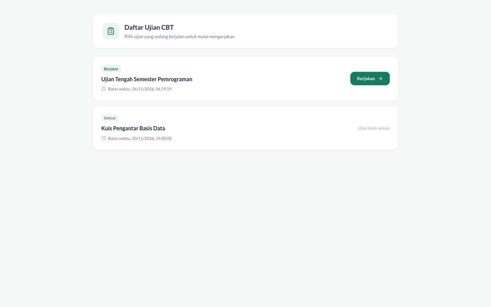
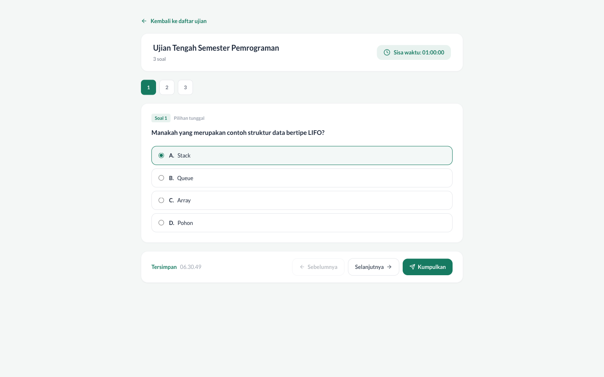
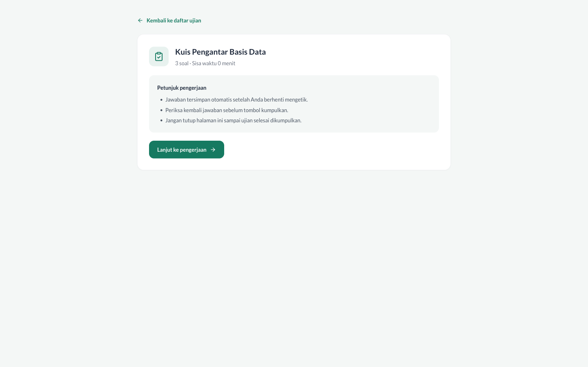
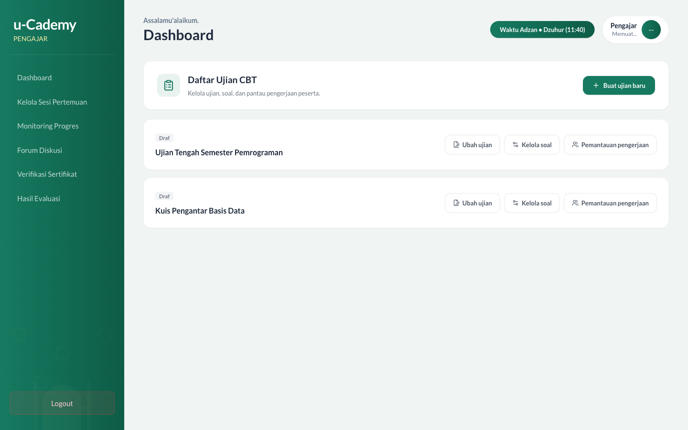
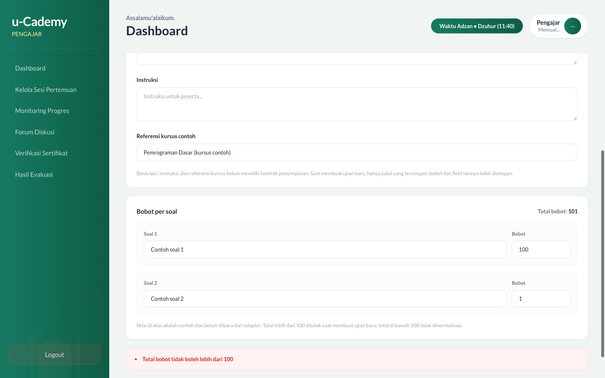
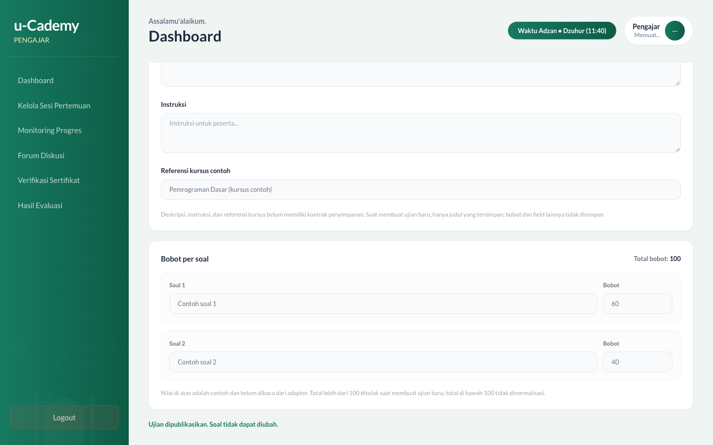
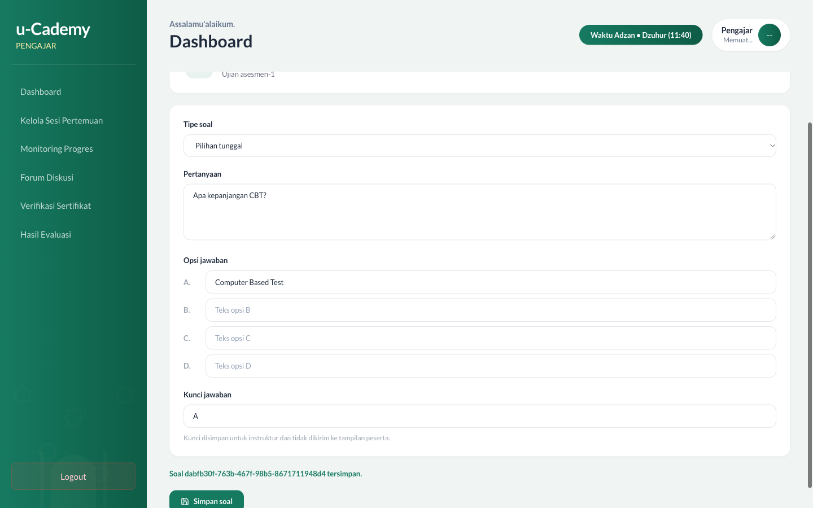
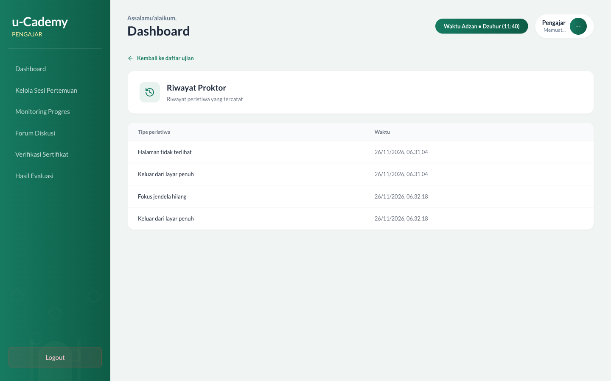
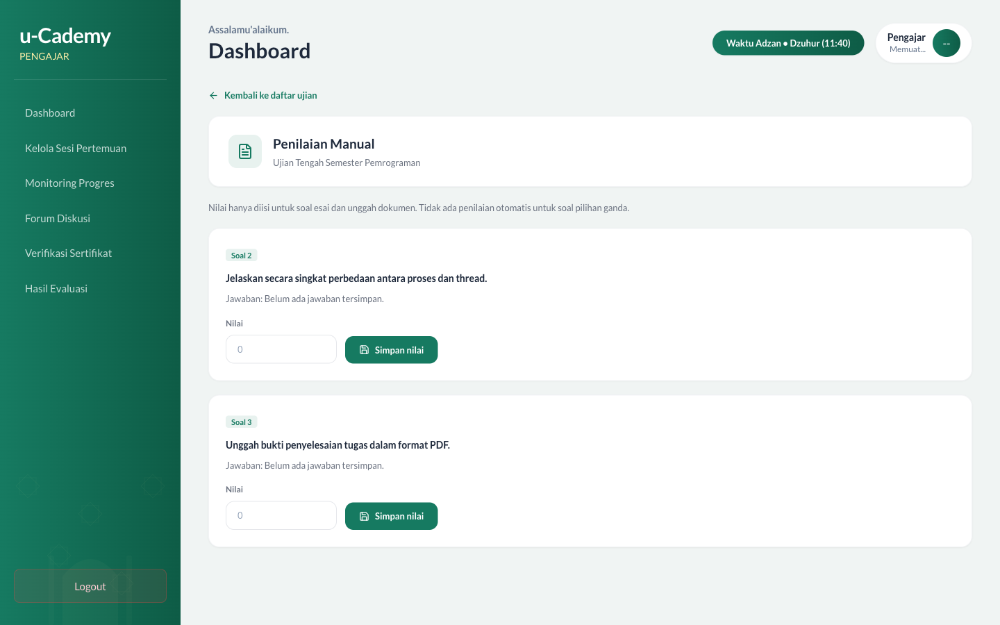
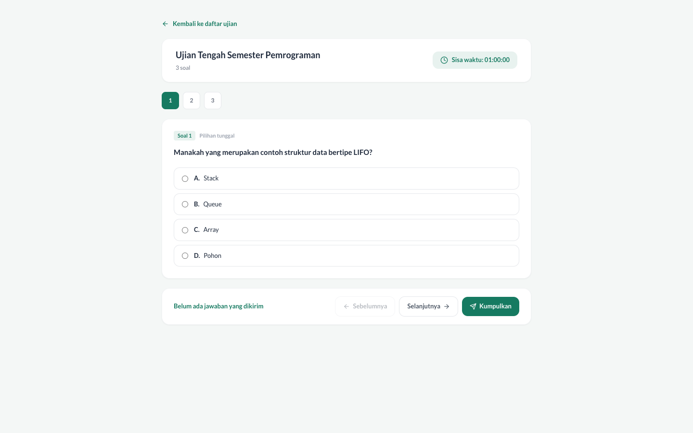

# Catatan Skripsi — Antarmuka Web CBT U-Cademy

Dokumen ini menyertai hasil pekerjaan antarmuka web CBT pada cabang `feat/cbt-web-ui`. Tujuannya adalah memudahkan penulisan skripsi dan pemeriksaan bukti: apa yang dibuat, apa yang menjadi batasan, apa yang sudah diarahkan pembimbing, apa yang masih terbuka, dan bagaimana hasilnya diverifikasi. Dokumen ini **bukan** dokumen persetujuan pembimbing dan tidak menggantikan [PRD CBT](../CBT-API.md), [matriks kebutuhan](cbt-requirements-matrix.md), atau [desain antarmuka](superpowers/specs/2026-11-25-cbt-web-ui-design.md).

## 1. Tujuan dan batas skripsi

Pekerjaan ini menambahkan **antarmuka web untuk API CBT mandiri** di dalam repositori frontend U-Cademy. Antarmuka ini dibuat untuk **keperluan pengembangan dan demonstrasi skripsi**, bukan untuk produksi.

Batas yang berlaku:

- Fase ini memakai **ID peserta, ID instruktur, dan ID kursus contoh** serta **mock adapter** lokal. Tidak ada autentikasi produksi, enrollment LMS, atau sinkronisasi nilai CBT baru.
- Antarmuka ini **tidak menggantikan** alur CBT yang sudah berjalan di LMS, yaitu `tugas.link_cbt`, `tugas.token_cbt`, dan `nilai_cbt`. Alur lama tetap menjadi satu-satunya jalur CBT yang didukung untuk tugas.
- Tidak ada perubahan pada `lms-backend/`, `lms-mobile/`, atau `cbt-api/`. Pekerjaan ini hanya menyentuh `lms-frontend/` dan dokumentasi terkait.
- Karena `cbt-api` belum memiliki endpoint bisnis maupun autentikasi, permintaan apa pun dari antarmuka ini **tidak boleh dianggap aman untuk dipakai publik** pada tahap ini.

## 2. Keputusan arsitektur yang sudah dibuat

Keputusan berikut adalah **keputusan implementasi penulis**, bukan keputusan dosen pembimbing, kecuali dinyatakan sebaliknya.

| Keputusan | Penjelasan | Status |
|---|---|---|
| Web-first | Antarmuka dibuat untuk web karena peristiwa proctoring berasal dari browser dan autosave lebih mudah diuji. | **Usulan penulis**, bukan konfirmasi platform. Q05 masih terbuka (ditujukan kepada Pak Fitrah). |
| Pendekatan A | UI di `lms-frontend` memanggil `cbt-api` secara langsung melalui **client HTTP kedua**, bukan lewat proxy `lms-backend`. | Dipilih untuk fase mandiri. Pendekatan B (proxy lewat backend) menunggu Q12 dan permintaan integrasi eksplisit. Frontend CBT terpisah (C) ditolak karena menggandakan sistem. |
| Client kedua | `src/config/cbtApi.js` memakai `VITE_CBT_API_BASE_URL` dan tidak memasang interceptor Bearer milik client LMS. Identitas pada fase ini masih ID contoh. | Keputusan implementasi. |
| `cbtAdapter` sebagai titik ganti | Seluruh UI memanggil `cbtAdapter` dari `src/services/cbt/index.js`, yang saat ini diekspor dari `mockAdapter.js`. Saat endpoint CBT tersedia, penggantian dilakukan di satu titik ekspor itu tanpa mengubah komponen. | Keputusan implementasi. Mock bukan kontrak API final. |
| Batas perubahan | `lms-backend`, `lms-mobile`, dan `cbt-api` tidak diubah; klien LMS yang lama tidak dimodifikasi. | Keputusan implementasi, sesuai batas repositori. |
| Kunci jawaban | Kunci disimpan di lapisan adapter/instruktur dan **tidak pernah dikirim ke peserta**; ada uji otomatis yang memeriksanya. | Mengikuti batas aman PRD; aturan visibilitas hasil (Q04) masih terbuka. |
| Soal setelah publikasi | Editor soal bersifat **read-only** setelah ujian berstatus `published`. | Mengikuti arahan yang sudah ada (No. 9 catatan konsultasi; CBT-R10 di matriks). Mekanisme koreksi (Q07) belum dibuat. |

Alasan memilih pendekatan A dan rincian alternatifnya ada di [desain antarmuka](superpowers/specs/2026-11-25-cbt-web-ui-design.md) Bab 5 dan 6.

## 3. Alur dan layar

### Peserta — tiga route

| Route | Layar | Perilaku |
|---|---|---|
| `/cbt` | Daftar ujian | Menampilkan ujian contoh beserta status dan batas waktu. Untuk ujian berstatus `berjalan`, tombol **Kerjakan** langsung mengarah ke `/cbt/attempt/:id`, yaitu **langsung ke pengerjaan**. |
| `/cbt/attempt/:id/konfirmasi` | Konfirmasi ujian | Menampilkan instruksi, jumlah soal, dan sisa waktu dari adapter; tombol lanjut menuju pengerjaan. Route ini tersedia, tetapi tombol **Kerjakan** pada daftar tidak melewatinya. |
| `/cbt/attempt/:id` | Pengerjaan ujian | Satu soal per tampilan, empat tipe soal (pilihan tunggal, pilihan ganda, esai, unggah dokumen), status autosave, dan tombol **Kumpulkan**. |

Catatan penting: alur yang diimplementasikan adalah **daftar → pengerjaan** untuk attempt yang sedang berjalan; halaman konfirmasi tetap ada sebagai route tersendiri. Keduanya berujung pada pengerjaan.

### Instruktur — enam route

Semua route instruktur berada di dalam `ProtectedRoute` berperan `dosen` dan layout dosen yang sudah ada; login web LMS tetap dipakai untuk membuka halaman ini.

| Route | Layar | Perilaku |
|---|---|---|
| `/dosen/cbt/ujian` | Daftar ujian | Daftar ujian beserta status draft/published. |
| `/dosen/cbt/ujian/:id/edit` | Editor ujian | Judul, deskripsi, instruksi, referensi kursus contoh, dan validasi bobot. |
| `/dosen/cbt/ujian/:id/soal` | Editor soal | Empat tipe soal dan kunci jawaban; read-only setelah publikasi. |
| `/dosen/cbt/ujian/:id/attempt` | Monitoring attempt | Daftar attempt dan statusnya. |
| `/dosen/cbt/attempt/:id/proctor` | Riwayat proctor | Daftar peristiwa beserta waktu, tanpa label kecurangan dan tanpa tindakan otomatis. |
| `/dosen/cbt/attempt/:id/nilai` | Penilaian | Form nilai manual untuk soal esai dan unggah dokumen. |

### Perilaku lintas layar

- **Autosave per soal:** debounce 800 ms dengan kunci idempotensi `cbt:<idAttempt>:<idSoal>` yang dipakai ulang saat **Coba lagi**. Antrean satu soal tidak menimpa antrean soal lain; tidak ada retry otomatis. Status hanya berubah menjadi "Tersimpan" setelah adapter mengonfirmasi.
- **`flush()` sebelum submit:** tombol **Kumpulkan** membatalkan timer yang tertunda, mengirim jawaban yang masih mengantre, dan menunggu semua pengiriman selesai sebelum `submitAttempt` dipanggil. Jika ada pengiriman gagal, pengumpulan dibatalkan dan pesan kesalahan ditampilkan; tombol tidak mengklaim berhasil.
- **Proctoring hanya mencatat:** peristiwa `tab_hidden`, `fullscreen_exit`, dan `window_blur` dicatat beserta waktunya. Tidak ada peringatan, penghentian ujian, atau pengurangan nilai, karena Q08 dan Q09 belum diputuskan. Catatan ini tidak boleh dinyatakan sebagai bukti kecurangan.
- **Penilaian manual terbatas:** hanya esai dan unggah dokumen yang dinilai manual. Nilai kosong, bukan angka, atau tak hingga ditolak sebelum `saveGrade` dipanggil, dengan validasi inline. Penilaian pilihan ganda ganda (Q01) tidak diterapkan.

## 4. Aturan yang sudah diputuskan versus masih menunggu

Sumber status: [matriks kebutuhan CBT](cbt-requirements-matrix.md) dan [catatan konsultasi](pertanyaan-konfirmasi-dosen-pembimbing-cbt.md). Matriks membedakan **Sudah diarahkan** (ada catatan dosen) dari keputusan detail yang belum disetujui.

### Sudah ada arahan

- **No. 9 catatan konsultasi / CBT-R10:** soal tidak boleh diubah setelah ujian dipublikasikan. UI menerapkannya sebagai editor read-only. Proses koreksi setelah publikasi (Q07) belum ada arahan.
- **CBT-R05:** total bobot maksimal 100. Validasi menolak total lebih dari 100, menolak bobot negatif dan bobot yang bukan angka (termasuk `Infinity` dan teks), serta menerima total di bawah 100 **apa adanya tanpa normalisasi otomatis**. Arti nilai akhir ketika total di bawah 100 (Q02) tetap merupakan pertanyaan terbuka; ini adalah perilaku validasi UI, bukan keputusan penilaian pembimbing.
- Arahan lain yang menjadi latar: empat tipe soal dalam satu ujian (CBT-R02), soal dibuat manual oleh pengajar (CBT-R03), bobot ditentukan pengajar (CBT-R04), pengaturan waktu (CBT-R06), pengacakan soal (CBT-R07), autosave dan kelanjutan attempt (CBT-R08), proctoring dasar (CBT-R09), dan dokumentasi setiap perubahan (CBT-R12). Detail yang masih bertanda "belum diputuskan" pada matriks tidak otomatis menjadi aturan.

### Masih menunggu pembimbing — CBT-Q01 sampai CBT-Q12

| ID | Ringkasan yang terbuka |
|---|---|
| Q01 | Penilaian pilihan ganda banyak jawaban: pencocokan tepat atau nilai sebagian. |
| Q02 | Arti nilai akhir jika total bobot kurang dari 100. |
| Q03 | Jumlah attempt yang diizinkan. |
| Q04 | Kapan hasil, nilai per soal, umpan balik, atau kunci jawaban boleh dilihat. |
| Q05 | Platform ujian: web, seluler, atau keduanya (ditujukan kepada Pak Fitrah). |
| Q06 | Format, ukuran maksimum, dan jumlah file jawaban yang diizinkan. |
| Q07 | Penanganan kesalahan soal setelah ujian dipublikasikan. |
| Q08 | Event proctoring yang wajib dicatat dan apakah berdampak pada status ujian. |
| Q09 | Tindakan jika peserta keluar dari mode layar penuh. |
| Q10 | Kapan timer mulai, apa yang terjadi saat waktu habis, serta jadwal versus durasi. |
| Q11 | Apakah opsi jawaban ikut diacak dan bagaimana urutan dipertahankan saat melanjutkan attempt. |
| Q12 | Identitas pengajar/peserta, referensi kursus, dan batas integrasi autentikasi/enrollment LMS. |

**Tegasan:** seluruh pilihan dalam rentang Q01–Q12 masih terbuka. Asumsi kerja yang dipakai agar UI dapat dibangun dan didemonstrasikan **tidak boleh ditulis sebagai keputusan dosen pembimbing** dalam skripsi. Sebelum menetapkan perilaku akhir, periksa kembali matriks dan catatan konsultasi, lalu catat sumber serta tanggal konfirmasinya sesuai CBT-R12.

## 5. Bukti verifikasi

Bukti berikut dirangkum dari [bukti verifikasi](bukti-verifikasi-cbt-ui.md) dalam repositori ini, yang mencatat hasil setelah perbaikan akhir. Perintah dijalankan dari worktree asal sebelum repositori `cbt-frontend` dibuat.

### 1. Seluruh uji murni CBT — 22/22 lulus

```bash
cd /Volumes/Backup/Irgi/NyobaNyobaBikinAplikasiWeb/U-Cademy/lms-frontend-cbt-ui
node --test src/lib/*.test.js src/services/cbt/*.test.js
```

Ringkasan output: `ℹ tests 22`, `ℹ pass 22`, `ℹ fail 0`. Uji mencakup mesin status autosave dan `flushAntrean`, validasi bobot, pemetaan error `cbt-api`, pemetaan peristiwa proctoring, larangan mengubah soal setelah publikasi, pengiriman kunci hanya ke instruktur, id soal unik dan salinan opsi, serta pemeriksaan bahwa `getAttempt` tidak mengirim kunci jawaban ke peserta.

### 2. Build produksi — lulus dengan peringatan bawaan

```bash
npm run build
```

Output: `✓ 2272 modules transformed`, `✓ built in 1.73s`. Muncul peringatan `[plugin builtin:vite-reporter] (!) Some chunks are larger than 500 kB after minification`; ini peringatan yang sudah ada sebelumnya dan tidak terkait perubahan CBT.

### 3. ESLint pada berkas yang diubah — lulus

```bash
npx eslint src/hooks/useAutoSave.js src/lib/autosave.js src/lib/autosave.test.js src/lib/bobot.js src/lib/bobot.test.js src/pages/dosen/cbt/EditorSoalPage.jsx src/pages/dosen/cbt/PenilaianPage.jsx src/pages/peserta/PengerjaanUjianPage.jsx src/services/cbt/mockAdapter.js src/services/cbt/mockAdapter.instruktur.test.js
```

Output: tidak ada pesan, kode keluar `0`.

### 4. Empat skenario browser

Server dev dijalankan terpisah dengan:

```bash
npm run dev -- --host 127.0.0.1 --port 5178 --strictPort
```

Skrip puppeteer sementara dijalankan dengan `node .cbt-final-fix-browser.mjs` dari root worktree, lalu dihapus. Skrip lengkap ada di Lampiran laporan `final-fix-report.md`; puppeteer sudah tersedia sebagai dependensi proyek, sehingga tidak ada dependency baru. Hasil yang dicatat:

1. **Urutan penyimpanan sebelum pengumpulan:** jawab soal terakhir lalu langsung klik **Kumpulkan** (di bawah 800 ms) → `["saveAnswer:start","saveAnswer:end","submitAttempt"]`; lulus.
2. **Id soal berbeda:** dua kali klik **Simpan soal** → dua UUID berbeda dan toast tanpa teks `undefined`; lulus.
3. **Bobot negatif ditolak:** uji murni `bobot negatif ditolak meskipun totalnya 100`, `bobot bukan angka ditolak`, `bobot tak hingga ditolak`, dan `bobot berupa teks ditolak` → lulus.
4. **Nilai kosong ditolak:** klik **Simpan nilai** pada kolom kosong → validasi "Nilai harus diisi dengan angka.", `saveGrade` tidak dipanggil, tidak ada klaim tersimpan; setelah diisi `85`, tepat satu panggilan `saveGrade` dengan `nilai: 85`; lulus.

Ringkasan laporan: `SEMUA SKENARIO BROWSER LULUS`.

### 5. Uji menyeluruh memakai Orca CLI — 26 November 2026

Pengujian dijalankan pada repositori `cbt-frontend` dengan terminal dan browser bawaan Orca (`orca terminal`, `orca tab`, `orca goto`, `orca snapshot`, `orca click`, `orca fill`, `orca eval`, `orca console`, `orca screenshot`). Dev server dijalankan di `http://127.0.0.1:5180/`; karena cache npm lokal menolak penulisan (`EACCES`), `node_modules` dipakai ulang dari worktree `lms-frontend` melalui symlink. Ini hanya penyesuaian lingkungan, bukan perubahan kode.

Hasil pengujian antarmuka secara menyeluruh:

| Alur | Tindakan di browser Orca | Hasil |
|---|---|---|
| Peserta — daftar | `/cbt` menampilkan attempt `berjalan` dan `selesai` | Lulus |
| Peserta — pengerjaan | Klik **Kerjakan** → **Mulai** → pilih jawaban soal 1 | Status berubah `Menyimpan…` lalu `Tersimpan` |
| Peserta — pengumpulan | Isi esai soal 2 lalu langsung klik **Kumpulkan** | "Jawaban berhasil dikumpulkan." — flush autosave bekerja |
| Peserta — konfirmasi | Buka `/cbt/attempt/attempt-2/konfirmasi` | Petunjuk dan tombol lanjut tampil |
| Instruktur — bobot | Total 101 → simpan; lalu `-10 + 110` → simpan | Berturut-turut ditolak: "Total bobot tidak boleh lebih dari 100" dan "Bobot tidak boleh negatif" |
| Instruktur — ujian baru | Total 60 + 40 → simpan | Halaman editor `asesmen-3` terbuka; tombol simpan dinonaktifkan untuk ujian yang sudah ada |
| Instruktur — soal | Simpan dua soal berturut-turut | Dua UUID berbeda di toast, tanpa teks `undefined` |
| Instruktur — publikasi | Klik **Publikasikan ujian** | Banner read-only tampil dan semua input disabled |
| Instruktur — monitoring | Buka halaman pemantauan attempt | Daftar pengerjaan tampil; riwayat proktor tanpa label kecurangan |
| Instruktur — penilaian | Simpan nilai kosong, lalu isi `85` | Validasi "Nilai harus diisi dengan angka."; setelah diisi, "Nilai tersimpan." |
| Otorisasi | Hapus token, buka `/dosen/cbt/ujian` | Dialihkan ke `/login` |

`orca console` tidak melaporkan error. Screenshot dibuat untuk halaman penilaian instruktur dan daftar ujian peserta. Batas yang teramati: membuka halaman dengan navigasi penuh (`goto`) menghilangkan state mock dalam memori, sehingga ujian yang baru dibuat tidak ditemukan — perilaku ini sudah tercantum dalam bagian Keterbatasan dan bukan bug penyimpanan server.

### 6. Uji end-to-end menyeluruh memakai agent-browser — 26 November 2026

Pengujian ulang dilakukan dengan `agent-browser` (sesi terisolasi `cbt-e2e-*`) terhadap dev server `http://127.0.0.1:5181/`. Berbeda dari uji Orca CLI yang memakai navigasi penuh, uji ini memakai alur klik dan navigasi SPA sehingga state mock tetap terjaga antarhalaman.

| Fitur | Hasil |
|---|---|
| Peserta: daftar attempt dan halaman konfirmasi | Lulus |
| Peserta: soal pilihan tunggal, esai, dan unggah dokumen | Ketiganya dapat diisi; indikator `Menyimpan…` → `Tersimpan` muncul |
| Peserta: pindah soal cepat dan submit langsung setelah mengubah jawaban | "Jawaban berhasil dikumpulkan." — `flush()` bekerja |
| Peserta: tiga peristiwa proctoring | `tab_hidden`, `window_blur`, `fullscreen_exit` tercatat; riwayat proktor menampilkan `window_blur` dan `fullscreen_exit` lewat navigasi SPA |
| Peserta: kunci jawaban | Tidak ada field `kunci` pada payload `getAttempt` |
| Instruktur: otorisasi | Tanpa token, `/dosen/cbt/ujian` dialihkan ke `/login` |
| Instruktur: validasi bobot | 101 ditolak; `-10 + 110` ditolak; `60 + 40` diterima |
| Instruktur: ujian yang sudah ada | Tombol simpan dinonaktifkan; setelah publikasi semua input disabled |
| Instruktur: empat tipe soal | Pemilihan tipe mengubah kolom formulir dengan benar; dua kali simpan menghasilkan dua UUID berbeda |
| Instruktur: kunci jawaban | Tersedia untuk instruktur, tidak dikirim ke peserta |
| Instruktur: monitoring, riwayat proctor, penilaian manual | Lulus; nilai kosong ditolak, nilai `88` tersimpan |

Console hanya mencatat error `Gagal mengambil data profil` dari layout LMS yang sudah ada karena backend LMS tidak dijalankan dalam pengujian ini; tidak ada error yang berasal dari fitur CBT.

### Tindak lanjut temuan uji (26 November 2026)

Tiga temuan di atas diperbaiki tanpa menunggu keputusan pembimbing karena semuanya berada di lapisan mock dan label tampilan, bukan aturan bisnis Q01–Q12:

1. **`saveAnswer` kini menyimpan jawaban ke state contoh.** `getAttempt` mengembalikan `jawabanTersimpan` yang benar-benar terisi. Status "Tersimpan" tetap hanya diberikan setelah adapter merespons; tidak ada retry otomatis atau aturan penilaian baru.
2. **Riwayat proktor memakai label Bahasa Indonesia.** `tab_hidden` → "Halaman tidak terlihat", `fullscreen_exit` → "Keluar dari layar penuh", `window_blur` → "Fokus jendela hilang". Ini hanya terjemahan kode event; jenis event wajib dan konsekuensinya tetap menunggu Q08/Q09.
3. **State mock bertahan saat reload** lewat `sessionStorage` (kunci `cbt-mock-state-v1`), termasuk jawaban, event proctor, dan status attempt yang sudah dikumpulkan.

Error `Gagal mengambil data profil` **tidak** diubah: berasal dari layout LMS lama dan hanya muncul karena backend LMS tidak dijalankan saat pengujian. Memperbaikinya berarti mengubah `lms-backend`/kode LMS, yang berada di luar batas skripsi CBT mandiri.

Verifikasi setelah perbaikan: 25/25 uji murni lulus, `npm run build` lulus, dan uji browser membuktikan jawaban tetap terbaca setelah reload, ketiga label proctor tampil, serta attempt berubah menjadi "Selesai" setelah dikumpulkan. Verifikasi lanjutan 28 November menambah 12 uji edge case menjadi **37/37 lulus**, menambahkan label aksesibilitas non-visual pada input jawaban, dan mengambil screenshot terbaru; rincian ada di [bukti verifikasi](bukti-verifikasi-cbt-ui.md).

### Catatan pengambilan bukti

`npm run lint` penuh **tidak** dipakai sebagai gate karena memiliki sekitar 103 kesalahan yang sudah ada sebelumnya di luar cakupan CBT. Untuk skripsi, sebutkan gate yang benar-benar dijalankan di atas, jangan menyatakan bahwa lint penuh lulus.

## 6. Keterbatasan yang diketahui

1. **State mock disimpan di `sessionStorage`:** data bertahan saat halaman dimuat ulang dalam tab yang sama, tetapi hilang pada tab/sesi baru atau bila kunci `cbt-mock-state-v1` dihapus. Ini perilaku adapter contoh, bukan bukti penyimpanan server. Untuk mengulang demo dari awal, hapus kunci tersebut di DevTools → Application → Session Storage.
2. **`crypto.randomUUID()` memerlukan konteks aman:** hanya tersedia di `localhost` atau HTTPS. Bila UI nanti dilayani lewat HTTP biasa bukan localhost, pembuatan id harus diganti.
3. **`npm run lint` penuh memiliki sekitar 103 error lama** di luar CBT. Pemeriksaan CBT memakai `npx eslint` pada berkas yang diubah saja.
4. **Penolakan fullscreen belum dicatat sebagai event:** ujian tetap berjalan, tetapi kondisi tersebut tidak menghasilkan catatan proctoring. Perilaku ini menunggu keputusan Q08/Q09.
5. **Halaman hasil sengaja tidak diaktifkan:** `HasilUjianPage` tidak dirender/default sampai visibilitas hasil (Q04) diputuskan. Tidak ada klaim nilai atau kunci jawaban untuk peserta.
6. **Integrasi belum ada:** autentikasi dan enrollment LMS, sinkronisasi nilai CBT baru, serta endpoint bisnis `cbt-api` belum tersedia. Client kedua dan adapter masih berupa persiapan untuk integrasi, bukan integrasi yang berjalan.
7. **Editor soal belum memiliki identitas entitas suntingan:** dua kali **Simpan soal** menghasilkan dua entri dengan id berbeda. Jika nanti ada alur sunting soal, id perlu diambil dari state/data yang dimuat.

## 7. Cara menjalankan dan menunjukkan

Dari root repositori `cbt-frontend`:

```bash
cp .env.example .env
# atur VITE_CBT_API_BASE_URL, misalnya http://127.0.0.1:8001/api
npm install
npm run dev -- --host 127.0.0.1
```

`VITE_CBT_API_BASE_URL` dipakai oleh `src/config/cbtApi.js`. Selama endpoint bisnis CBT belum ada, antarmuka tetap memakai mock adapter, sehingga nilai URL tersebut tidak harus aktif untuk demonstrasi.

**Jalur demo peserta:** buka `/cbt` → tombol **Kerjakan** → `/cbt/attempt/:id` → pilih jawaban (status autosave muncul) → **Kumpulkan**. Route `/cbt/attempt/:id/konfirmasi` dapat ditunjukkan terpisah. Untuk mencoba unggah dokumen, siapkan satu berkas teks/PDF contoh; validasi format dan ukuran sengaja belum diterapkan (Q06).

**Jalur demo dosen:** masuk dengan akun peran dosen yang sudah ada → `/dosen/cbt/ujian` → `.../edit` (coba total bobot lebih dari 100 dan bobot negatif) → `.../soal` (simpan dua kali; coba ubah setelah status `published`) → `.../attempt` → `attempt/:id/proctor` → `attempt/:id/nilai` (coba nilai kosong, lalu isi angka).

**Dokumen terkait:**

- [Dokumen cakupan seluruh CBT](cakupan-seluruh-cbt.md) — peta ekosistem, status implementasi, dan keputusan terbuka.
- [Diagram cakupan](diagram-cakupan.html) — visualisasi arsitektur dan batas cakupan; versi [PNG](diagram-cakupan.png) dan [SVG](diagram-cakupan.svg).
- [PRD API CBT](../CBT-API.md) — kebutuhan dan kontrak API.
- [Matriks kebutuhan CBT](cbt-requirements-matrix.md) — status arahan pembimbing dan Q01–Q12.
- [Catatan dan pertanyaan konsultasi](pertanyaan-konfirmasi-dosen-pembimbing-cbt.md) — sumber arahan, termasuk No. 9.
- [Lembar konsultasi satu halaman](lembar-konsultasi-cbt.md) — 12 butir terbuka dengan ruang jawaban dan tanggal.
- [Desain antarmuka web CBT](superpowers/specs/2026-11-25-cbt-web-ui-design.md) — keputusan arsitektur dan usulan penulis.
- [Rencana implementasi peserta](superpowers/plans/2026-11-25-cbt-web-ui-peserta.md) dan [rencana implementasi instruktur](superpowers/plans/2026-11-25-cbt-web-ui-instruktur.md).
- [README frontend](../README.md) — petunjuk pengembangan umum.
- [Bukti verifikasi](bukti-verifikasi-cbt-ui.md) — laporan lengkap uji, build, dan skenario browser.

## 8. Lampiran tampilan

Tampilan berikut diambil dari uji menyeluruh dengan `agent-browser` (browser terlihat, viewport 1440×900) pada 26 November 2026.

| Layar | Bukti |
|---|---|
| Daftar ujian peserta |  |
| Pengerjaan dengan indikator tersimpan |  |
| Konfirmasi sebelum mengerjakan |  |
| Daftar ujian instruktur |  |
| Validasi total bobot |  |
| Editor setelah publikasi (read-only) |  |
| Editor soal |  |
| Riwayat proktor |  |
| Penilaian manual |  |
| Pengerjaan dengan label aksesibilitas (28 November 2026) |  |
